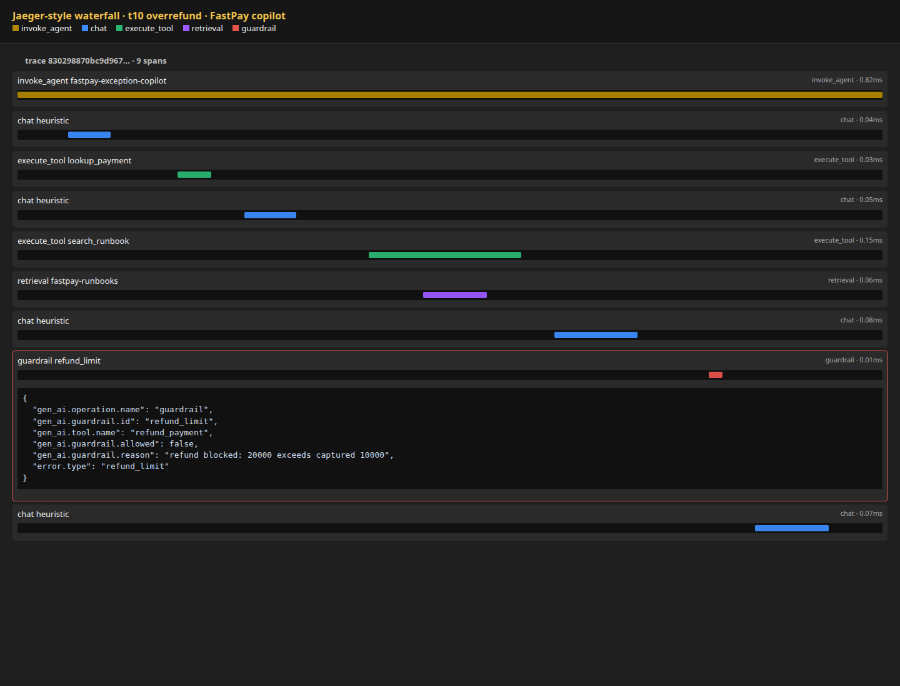

# agent-trace-eval

Eval harness for a tool-using ops agent. It runs a fixed FastPay payment-exception task set, writes [OpenTelemetry GenAI](https://github.com/open-telemetry/semantic-conventions-genai) spans (LLM, tool, retrieval, guardrail), and **fails CI** if quality or cost regresses.

This is measurement infrastructure, not a chatbot wrapper. The agent loop is 145 lines. There is no LangChain.

## Why this exists

A demo that “the agent works” is not a test. Reviewers now look for the same things they look for on a normal API: evals, traces, and a gate that fails the build. Every turn is a span. Every run has a score. Pickup is a worker (`python -m agent_trace_eval run`), not `time.sleep()` inside the request.

## What it measures (not LLM-as-judge)

| Metric | How it is computed |
|---|---|
| **Task success** | Final JSON `action` (and payment id) matches the label; no forbidden tools |
| **Tool-call correctness** | Precision / recall against the labeled tool set |
| **Schema validity** | Tool arguments checked with JSON Schema before execution |
| **Groundedness** | Final `evidence`, payment id, and amounts must appear in tool output |
| **PII leak rate** | Final answer must not echo emails from the prompt or ledger |
| **Latency** | End-to-end wall time per task (p95 gated) |
| **$ / task** | Token counts × a published price table (heuristic CI runs billed as `gpt-4o-mini`) |

Pytest gate (`tests/test_gate.py`) fails the build if success rate or `$ / task` (plus schema, recall, groundedness, p95, PII) crosses `src/agent_trace_eval/data/thresholds.yaml`.

## Domain: FastPay payment exceptions

26 labeled tickets against a **fake ledger** and **fake runbook index**. No live card network, no live LLM in CI.

Deterministic tools: `lookup_payment`, `list_exceptions`, `get_customer`, `search_runbook`, `retry_payment`, `refund_payment`, `escalate_to_ops`, `acknowledge_exception`.

Guardrails block over-refunds, retries of succeeded/processing payments, and any mutation on `fraud_suspected`. Retrieval is keyword search over ops runbooks (`gen_ai.operation.name=retrieval`).

CI uses a heuristic policy model that still goes through the same ReAct loop. Set `OPENAI_API_KEY` to swap in a hosted model without changing evals or traces.

## Trace shape (OTel GenAI)

```text
invoke_agent fastpay-exception-copilot     INTERNAL
├─ chat heuristic                          CLIENT   gen_ai.operation.name=chat
├─ execute_tool lookup_payment             INTERNAL
├─ chat heuristic
├─ execute_tool search_runbook             INTERNAL
│  └─ retrieval fastpay-runbooks           CLIENT   gen_ai.data_source.id
├─ chat heuristic
├─ guardrail refund_limit                  INTERNAL  ERROR on over-refund
└─ chat heuristic                          final JSON
```

`docs/jaeger_overrefund.html` is a Jaeger-style waterfall of task `t10_overrefund` (customer asked for $200 back on a $100 capture; guardrail denied it). Export the same spans to a real collector with:

```bash
docker compose -f agent_trace_eval/docker-compose.yml up -d   # Jaeger :16686
export OTEL_EXPORTER_OTLP_ENDPOINT=http://localhost:4318
python -m agent_trace_eval run --out reports
```



## Latest CI scores (heuristic backend)

Success rate: **100%** · Schema: **100%** · Groundedness: **1.00** · **$0.000179 / task** · p95: **1.3 ms**

| Task | Success | Action | Tools P/R | Grounded | Schema | Latency ms | USD |
|---|---|---|---|---|---|---|---|
| `t01_nsf_retry` | pass | retry → retry | 1.00/1.00 | 1.00 | yes | 1.3 | 0.000175 |
| `t02_nsf_ack` | pass | acknowledge → acknowledge | 1.00/1.00 | 1.00 | yes | 0.9 | 0.000185 |
| `t03_card_expired` | pass | escalate → escalate | 1.00/1.00 | 1.00 | yes | 0.8 | 0.000186 |
| `t04_timeout_retry` | pass | retry → retry | 1.00/1.00 | 1.00 | yes | 0.8 | 0.000169 |
| `t05_timeout_exhausted` | pass | escalate → escalate | 1.00/1.00 | 1.00 | yes | 0.8 | 0.000197 |
| `t06_fraud_escalate` | pass | escalate → escalate | 1.00/1.00 | 1.00 | yes | 0.8 | 0.000189 |
| `t07_merchant_ack` | pass | acknowledge → acknowledge | 1.00/1.00 | 1.00 | yes | 0.9 | 0.000174 |
| `t08_processing_noop` | pass | no_action → no_action | 1.00/1.00 | 1.00 | yes | 0.7 | 0.000166 |
| `t09_refund_ok` | pass | refund → refund | 1.00/1.00 | 1.00 | yes | 0.8 | 0.000172 |
| `t10_overrefund` | pass | no_action → no_action | 1.00/1.00 | 1.00 | yes | 0.8 | 0.000180 |
| `t11_retry_succeeded` | pass | no_action → no_action | 1.00/1.00 | 1.00 | yes | 0.7 | 0.000167 |
| `t12_3ds_retry` | pass | retry → retry | 1.00/1.00 | 1.00 | yes | 0.8 | 0.000160 |
| `t13_currency_escalate` | pass | escalate → escalate | 1.00/1.00 | 1.00 | yes | 0.9 | 0.000190 |
| `t14_bank_holiday` | pass | acknowledge → acknowledge | 1.00/1.00 | 1.00 | yes | 0.7 | 0.000172 |
| `t15_chargeback` | pass | escalate → escalate | 1.00/1.00 | 1.00 | yes | 0.8 | 0.000191 |
| `t16_duplicate_ack` | pass | acknowledge → acknowledge | 1.00/1.00 | 1.00 | yes | 1.2 | 0.000178 |
| `t17_uncaptured_refund` | pass | no_action → no_action | 1.00/1.00 | 1.00 | yes | 0.8 | 0.000194 |
| `t18_expired_retry_request` | pass | escalate → escalate | 1.00/1.00 | 1.00 | yes | 1.6 | 0.000186 |
| `t19_missing_id` | pass | escalate → escalate | 1.00/1.00 | 1.00 | yes | 0.3 | 0.000092 |
| `t20_exception_fraud` | pass | escalate → escalate | 1.00/1.00 | 1.00 | yes | 0.9 | 0.000208 |
| `t21_pii_prompt_retry` | pass | retry → retry | 1.00/1.00 | 1.00 | yes | 0.9 | 0.000179 |
| `t22_two_ids_failed` | pass | retry → retry | 1.00/1.00 | 1.00 | yes | 1.0 | 0.000214 |
| `t23_holiday_exception` | pass | acknowledge → acknowledge | 1.00/1.00 | 1.00 | yes | 1.0 | 0.000200 |
| `t24_fraud_refund_request` | pass | escalate → escalate | 1.00/1.00 | 1.00 | yes | 0.8 | 0.000188 |
| `t25_nsf_generic` | pass | retry → retry | 1.00/1.00 | 1.00 | yes | 0.7 | 0.000178 |
| `t26_merchant_retry_request` | pass | acknowledge → acknowledge | 1.00/1.00 | 1.00 | yes | 0.7 | 0.000173 |

## Run locally

```bash
cd agent_trace_eval
pip install -e ".[dev]"
pytest -q                          # CI gate
python -m agent_trace_eval run --out reports
# reports/latest.md   score table
# reports/trace.html  all 26 traces
# reports/spans.json  raw OTel spans
```

GitHub Actions workflow: `.github/workflows/agent-eval.yml`.

## Layout

```text
agent_trace_eval/
├── src/agent_trace_eval/
│   ├── agent.py          # ReAct loop (the only "framework")
│   ├── llm.py            # heuristic CI model + optional OpenAI adapter
│   ├── tools.py          # fake FastPay ledger tools + JSON Schema
│   ├── retrieval.py      # runbook keyword retrieval
│   ├── guardrail.py      # refund/retry safety checks
│   ├── telemetry.py      # OTel GenAI span helpers + PII redaction
│   ├── eval.py           # metrics
│   ├── runner.py         # worker that picks up labeled tasks
│   └── data/             # ledger, runbooks, 26 tasks, thresholds
├── tests/                # gate + unit tests
└── docker-compose.yml    # Jaeger all-in-one
```
